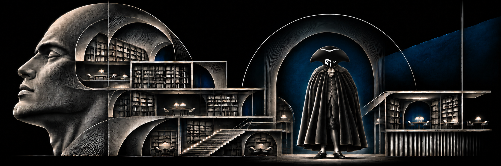
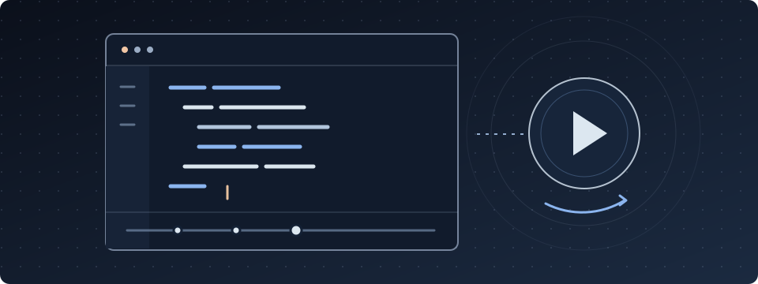
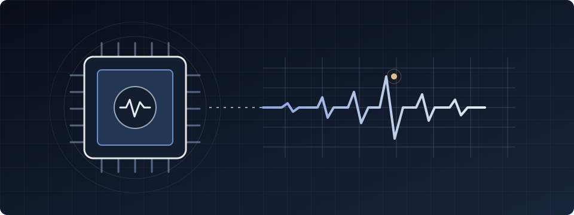
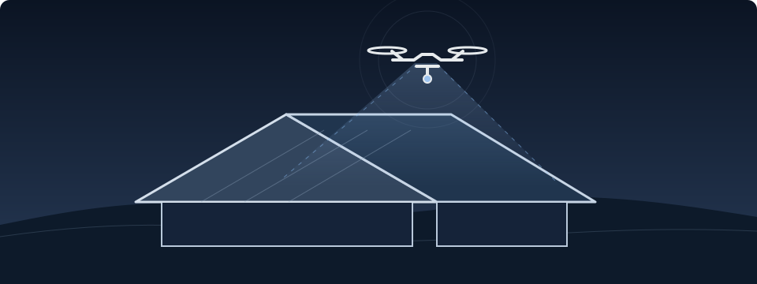
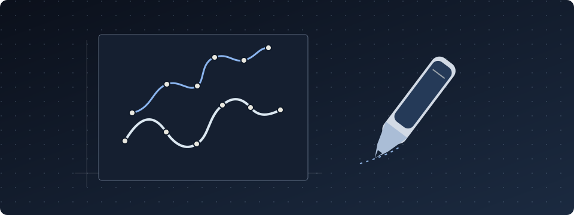

  

### Forward Deployed Engineer · Applied AI & product · Senior full-stack

**AI agents · RAG · MCP · Product engineering**

I work where a real-world problem meets the systems needed to solve it: understanding the use case, designing the product, building the software and making AI useful to the people who work with it.

The projects below show how I explore that work in practice — from inspectable agents and human-reviewed workflows to interactive learning, local AI and systems experiments.

[**LinkedIn ↗**](https://www.linkedin.com/in/nicolas-hedoire-1734775b/) &nbsp; · &nbsp; [**All repositories ↗**](https://github.com/nicolashedoire?tab=repositories)

---

## Agents, tools & applied AI

### [Sidecraft](https://github.com/nicolashedoire/sidecraft) · Watch software take shape

A macOS AI coding companion that writes and revises code visibly in VS Code. Its Swift agent engine supports local Ollama models and a separate Claude/MCP workflow. Recorded Claude/MCP sessions can be replayed as a structured development film, including file changes, commands and execution traces.

Private repository · access limited to authorized collaborators.

### [SDK AI Agents](https://github.com/nicolashedoire/sdk-ai-agents) · Making an agent's reasoning inspectable

A TypeScript SDK that gives an agent an explicit state: observations, hypotheses and contradictions can be inspected as it works. It combines evidence-aware decisions, event replay, cost and trace tracking, and MCP client/server bridges. [Explore the documentation ↗](https://nicolashedoire.github.io/sdk-ai-agents/)

### [Kadran MCP Proof](https://github.com/nicolashedoire/kadran-mcp-proof) · Connecting an agent to business operations

A local Mistral agent brings together a fictional inbox, CRM, catalog and quoting service through MCP. The quote service checks customer, quantity and pricing data independently, records tool activity and leaves approval to a human. Built as a Docker demonstrator using synthetic data.

### [Harness Pilot](https://github.com/nicolashedoire/harness-pilot) · A control room for development agents

A self-hosted workspace for persistent project conversations with Claude Code and Codex. It brings together agent discussions, parallel roles, project memory and tasks so people can inspect and guide work as it progresses.

### [Structured World Models](https://github.com/nicolashedoire/structured-world-models) · Looking beyond one-step predictions

A research project investigating how prediction errors accumulate when an agent plans several steps ahead. It compares models and planning on reproducible synthetic systems, with an oracle used to validate the experiments.

### [n8n Docker](https://github.com/nicolashedoire/n8n-docker) · Putting human review into an AI workflow

A local n8n setup with an importable workflow for AI-assisted qualification. The example shows how automation and human judgment can work together in a practical process.

## Interactive products & experiences

### [Île des Possibles](https://github.com/nicolashedoire/ile-des-possibles) · Learning by changing the system

An interactive 3D environment for exploring energy trade-offs. Change production, demand and storage across a simulated day, compare scenarios and see where shortages emerge. The model and data are intentionally simplified for learning. [Try the experience ↗](https://nicolashedoire.github.io/ile-des-possibles/)

### [Apple-1 Lab](https://github.com/nicolashedoire/apple-1-lab-site) · Understanding a computer from the inside

An interactive journey through the Apple-1, from assembling a 3D board to stepping through 6502 instructions and watching registers and memory change. A teaching tool designed to make the machine tangible. [Explore the lab ↗](https://nicolashedoire.github.io/apple-1-lab-site/)

### [Morphé Motion](https://github.com/nicolashedoire/morphe-motion-poc) · Teaching a correction to a scene

An editable 2D motion playground that explores whether a correction to an object's orientation can be captured and applied to another character. It uses inverse kinematics and a reusable symbolic rule. [Try the demo ↗](https://nicolashedoire.github.io/morphe-motion-poc/)

### [Vibration AI](https://github.com/nicolashedoire/vibration-ia) · Bringing anomaly detection to the edge

An ESP32 and vibration sensor learn a local baseline and score unusual behaviour on the device, with live readings in a web dashboard. The interface distinguishes simulated data from real sensor data.

### [ToitScan](https://github.com/nicolashedoire/toitscan) · A full-stack product prototype

A Next.js website and booking flow for drone-based roof inspection, including local landing pages and a request endpoint. The repository documents which pieces — including payments and notifications — remain to be implemented.

## Developer tools & research

### [Substrat](https://github.com/nicolashedoire/substrat-landing) · Exploring network protocols

A tool presented for analysing PCAP captures, inferring protocol structure, detecting anomalies and exporting artefacts such as Wireshark dissectors. The public repository contains its website, documentation and binaries. [Visit the site ↗](https://nicolashedoire.github.io/substrat-landing/)

### [Devenir DevOps](https://github.com/nicolashedoire/devenir-devops) · Following one application towards production

The French-language companion to my book follows a TaskBoard application through ten practical milestones: local development, Docker, CI, Kubernetes, observability, security and more, with guides and exercises. [Find the book on Amazon ↗](https://www.amazon.fr/dp/B0HKYFCRBK)

### [Pagecodec Lab](https://github.com/nicolashedoire/pagecodec-lab) · Testing ideas about compression and memory

A low-level lab for lossless page compression, compressed-data queries and memory strategies. It includes reproducible benchmarks, real datasets and negative results, keeping the scope of its findings explicit.

### [ProtoLife](https://github.com/nicolashedoire/protolife) · Simulating building blocks of life

A pre-alpha simulation exploring protocells, chemistry and vesicle growth and division, with a C11 core and a Godot visualisation. An experiment in building and observing simple systems.

### [Drawer Model](https://github.com/nicolashedoire/drawer-model) · Exploring drawing as a program

A local experiment that represents drawings as stroke programs, with CLIP-based critique and MCP tools. Its current scope is a limited drawing corpus rather than unrestricted image generation.

---

Based in France · Applied AI, product thinking and software engineering.
