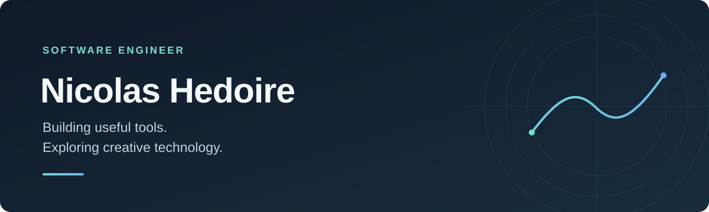

  

I'm a software engineer based in Douai, France. I enjoy building practical tools and exploring the space between automation, AI and creative technology.

### Selected projects

**[Harness Pilot](https://github.com/nicolashedoire/harness-pilot)** · A self-hosted workspace for working with development agents.

**[Morphé Motion](https://github.com/nicolashedoire/morphe-motion-poc)** · An animation playground for directing a scene and transferring corrections between characters. [Try the demo ↗](https://nicolashedoire.github.io/morphe-motion-poc/)

**[L’Atelier n8n](https://github.com/nicolashedoire/n8n-docker)** · A local n8n setup with a ready-to-import workflow for AI-assisted qualification and human review.

**[REST + GraphQL Mock Server](https://github.com/nicolashedoire/mock-server-rest-graphql)** · A mock server generated from a single endpoint configuration.

---

Based in France · Always curious about what we can build next.
