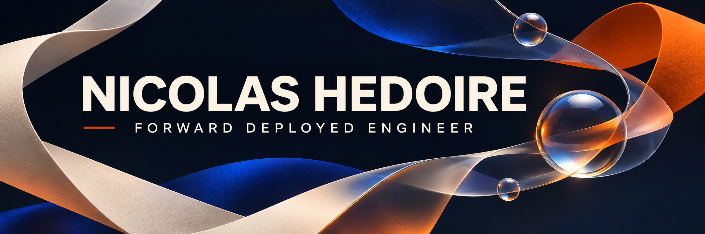

  

### Applied AI & product · AI agents, RAG & MCP · Senior full-stack

I work at the intersection of **applied AI, product thinking and software engineering**: turning real-world needs into useful tools, from the first prototype to the full-stack experience around it.

My work explores agent systems, human-in-the-loop workflows, developer tools and interactive products. I care about making complex technology understandable, practical and usable.

[**Connect on LinkedIn ↗**](https://www.linkedin.com/in/nicolas-hedoire-1734775b/) &nbsp; · &nbsp; [**Explore all repositories ↗**](https://github.com/nicolashedoire?tab=repositories)

---

## Building with AI

**[SDK AI Agents](https://github.com/nicolashedoire/sdk-ai-agents)**  
A TypeScript SDK for building agents with MCP client and server support, inspectable state, traces and cost tracking. [Documentation ↗](https://nicolashedoire.github.io/sdk-ai-agents/)

**[Kadran MCP Proof](https://github.com/nicolashedoire/kadran-mcp-proof)**  
A local Mistral agent connected to four MCP services to prepare traceable quotes, with human review and synthetic data.

**[Harness Pilot](https://github.com/nicolashedoire/harness-pilot)**  
A self-hosted workspace for organizing and working with development agents such as Claude Code and Codex.

**[Vibration AI](https://github.com/nicolashedoire/vibration-ia)**  
An embedded anomaly-detection prototype combining an ESP32, a vibration sensor and a web dashboard.

  

## From ideas to experiences

**[Île des Possibles](https://github.com/nicolashedoire/ile-des-possibles)**  
An interactive 3D learning experience for exploring energy systems and the effects of different choices. [Live demo ↗](https://nicolashedoire.github.io/ile-des-possibles/)

**[Apple-1 Lab](https://github.com/nicolashedoire/apple-1-lab-site)**  
A hands-on journey through the Apple-1, with an interactive 3D board and programming activities. [Live demo ↗](https://nicolashedoire.github.io/apple-1-lab-site/)

**[Morphé Motion](https://github.com/nicolashedoire/morphe-motion-poc)**  
An animation playground for directing a scene, teaching a correction and transferring it between characters. [Live demo ↗](https://nicolashedoire.github.io/morphe-motion-poc/)

## More to explore

**[Structured World Models](https://github.com/nicolashedoire/structured-world-models)** · Experiments in predictive models and planning agents using simulated environments.  
**[Devenir DevOps](https://github.com/nicolashedoire/devenir-devops)** · A French-language learning companion covering development, containers, CI, Kubernetes and observability.  
**[n8n Docker](https://github.com/nicolashedoire/n8n-docker)** · A local n8n setup and an AI-assisted workflow with human review.

---

Based in France · Building at the intersection of AI, product and engineering.
